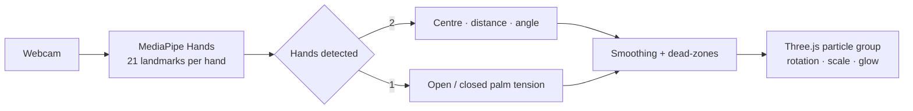

# Gesture-Controlled 3D Particle System

[](https://handmovement.vercel.app)


[](LICENSE)

An interactive 3D particle sculpture that you control with your hands through a webcam. It needs no mouse or keyboard. Hand landmarks are tracked in real time with **MediaPipe Hands**, and the particles are rendered with **Three.js**.

**[Try the live demo →](https://handmovement.vercel.app)** (allow camera access)

## Features

- **Two-hand control**
  - The midpoint between your hands rotates the shape on the X and Y axes.
  - The distance between your hands zooms and expands it.
  - The angle between your hands rolls it on the Z axis.
- **One-hand control**
  - An open palm expands the particles and a fist contracts them. This uses the thumb-to-index distance.
- **Shape templates:** Sphere, Heart, Flower, Saturn, Buddha and Fireworks, with smooth morphing between them.
- **Live tuning panel:** rotation and expansion sensitivity, gesture smoothing, particle size, colour and auto-rotate speed.
- **Stable motion:** dead-zones and linear interpolation filter out hand-tracking jitter.
- **Runs locally:** all processing happens in your browser. No video leaves your device.

## How it works



## Run locally

```bash
git clone https://github.com/lohithaksh123/handmovement.git
cd handmovement
npm install
npm run dev
```

Open the URL Vite prints, usually http://localhost:5173, and allow camera access.

## Tech stack

JavaScript · Three.js · MediaPipe Hands · Vite · Vercel

## License

MIT. See [LICENSE](LICENSE).
